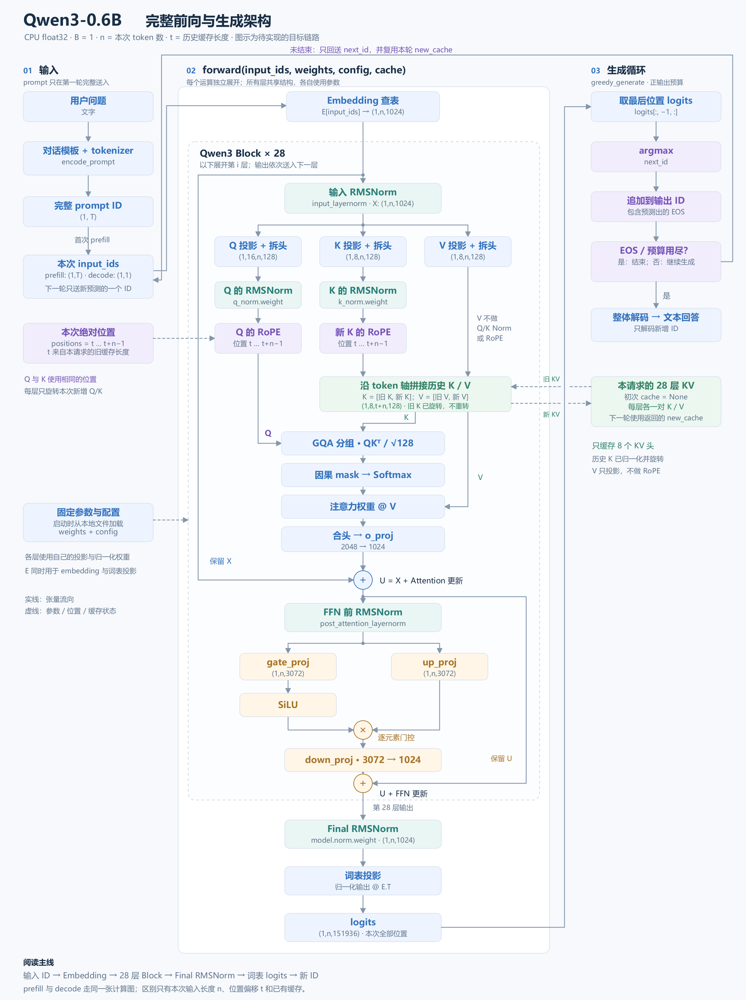

# 021：用真实 Qwen3 权重，手写完整推理

目标不是重新训练，而是让**你写的前向和生成代码**加载 Hugging Face 上的真实模型并回答问题。
选用 `Qwen/Qwen3-0.6B`，固定 revision `c1899de289a04d12100db370d81485cdf75e47ca`。
先读 [接入讲义](../../notes/qwen3-inference-from-checkpoint.md)：只补齐与已有 LLaMA 风格实现不同的接缝。

范围：CPU float32、无 PAD、无 Dropout、完整因果 GQA；模型前向支持等长 batch，demo 只生成一条请求。
首版贪心，不含量化、GPU 内核、滑窗、HTTP 服务、多请求调度或训练。

## 架构总览



图中紫色部分对应下面的待填函数，不表示模型已经实现。
`n` 是本次送入的 token 数，`t` 是旧缓存长度；prefill 与 decode 调用同一个 `forward`。
完整的 [单个 Qwen3 Block 放大图](../../notes/assets/qwen3-inference/block.png)
标出了 Q/K Norm、RoPE、GQA、缓存追加、两条残差和 SwiGLU；
讲义的“整个 demo 的计算架构”小节有图旁说明。

## 你填写哪里

需要完成 [model.py](model.py) 的 6 个核心函数。可以查基础 API、讲义和旧练习，但这次不直接调用旧整模型：

| 函数 | 串起的内容 |
|---|---|
| `rms_norm` | 主干与 Q/K 的末轴归一化 |
| `apply_rope` | 半分配对、真实 theta 与绝对位置 |
| `grouped_attention` | GQA 分组、缩放与矩形因果 mask |
| `transformer_block` | Q/K Norm、Attention/FFN 两条残差、紧凑 KV 追加 |
| `forward` | embedding、所有层、final norm、共享词表投影 |
| `greedy_generate` | prefill 一次、逐 token decode、EOS 与输出预算 |

投影可以直接写 `x @ weight.T`；`linear` 是可选的辅助函数，不单独测试，也不要求保留或调用。
投影结果仍随 Block 和完整模型的数值对齐一起验证。

每个函数的 docstring 已给出对象来源、shape、返回值和边界。核心可用 Tensor 运算与 `torch.softmax`，
禁止用 HF 模型、`.generate()`、`nn.Transformer`、`nn.MultiheadAttention`、SDPA、现成归一化/FFN/线性层代做。
从 `support.py` 导入的配置和缓存对象不含模型数学。生成循环不得通过 `compare_hf.py` 绕过实现。

## 如何推进

所有命令都在仓库根目录执行；先做小测试，不必先下载权重。

### A. 不下载、不新增依赖，先打通小模型

```bash
.venv/bin/python -B -m unittest tests.exercises.test_qwen3_inference -v
```

建议依次完成基础运算、完整块、forward、生成。
空脚手架预期有一项“尚未完成”失败，其余未实现的行为测试暂跳过，教师辅助测试独立运行。
这是待完成状态，不是通过；最终必须全部实际执行通过，不能剩 skip。

测试会检查非方阵权重、`C != Hq*D`、非均匀 Q/K gamma、半分 RoPE、GQA 头映射、未来信息隔离，
以及多种缓存切分、旧 cache 不变、请求隔离、结束符和生成调用顺序。
CPU float32，局部与固定小模型的容差为 `atol=rtol=2e-5`。确定性夹具与教师参照不依赖大模型文件。
固定数值是教师测试，不是你独立设计测试的证据。

### B. 接入官方随机小模型作裁判

可选依赖写在 [requirements-hf.txt](requirements-hf.txt)。现有课程环境不需要为 A 阶段安装它们。
准备运行下面的 HF 工具时，可自行执行以下命令向当前 `.venv` 增加依赖；本次准备没有替你执行这一步：

```bash
uv pip install --python .venv/bin/python -r exercises/ex021_qwen3_inference/requirements-hf.txt
.venv/bin/python -B -m exercises.ex021_qwen3_inference.compare_hf --tiny
```

若你选择单独的 Python 环境，在该环境安装 PyTorch 与此依赖文件，再用该解释器替换命令前缀即可。
固定 `transformers==4.51.3` 是数值参照版本，不是“最新版本”的声明。
运行 `--tiny` 不下载模型：官方实现与自写代码拿到同一份小随机权重和 ID，
比较完整 logits、两 token 追加、单 token decode，容差 `atol=rtol=5e-5`。

这里让 HF 当裁判是明确许可；正式 demo 不实例化它的模型类。
如果只打印相同 argmax，但 logits 数值不通过，仍需排错。

### C. 显式下载一次真实 checkpoint

先看计划，不联网：

```bash
.venv/bin/python -B -m exercises.ex021_qwen3_inference.download --dry-run
```

确认后再运行实际下载：

```bash
.venv/bin/python -B -m exercises.ex021_qwen3_inference.download
```

默认目录 `checkpoints/Qwen3-0.6B` 已被仓库忽略，不要提交权重。
固定权重文件约 1.50 GB；模型存成 BF16，加载器先检查共享词表一致，再转 CPU float32。
去重后的 FP32 参数约 2.22 GiB，**不是运行内存上限**，还需缓存、中间结果和加载空间。
其他设备已下载同一 snapshot 时，直接传 `--model-dir /你的本地目录`，不需要重复下载。
文件适配只支持此处的单个 `model.safetensors`，不支持 GGUF、量化、分片或任意 Qwen 变体。

### D. 真实数值对齐，再运行自己的聊天 demo

```bash
.venv/bin/python -B -m exercises.ex021_qwen3_inference.compare_hf --model-dir checkpoints/Qwen3-0.6B
.venv/bin/python -B -m exercises.ex021_qwen3_inference.demo --prompt "用一句话解释什么是 KV Cache。" --max-new-tokens 64
```

两个入口都只读本地文件，不自动联网。可加 `--threads 4`，也可按机器实际情况调节；不承诺线程越多越快。
真实对照使用同一模板产生的 ID、CPU float32、HF eager、关闭求导，比较每个位置的全部词表分数。
工具先释放官方模型，再加载自写模型权重，避免常驻两套大模型。
真实 checkpoint 的初始容差为 `atol=5e-4, rtol=1e-4`，**尚未在完整权重上实测**；
若超限，先定位最早偏差层并核查计算，再依据明确的数值证据调整，不能为通过而随意放宽。

demo 使用官方非思考聊天模板，结束集合读取 `generation_config.json`，
由你的 `greedy_generate` 产生新增 ID，再整体解码。贪心只是排错基线，不代表官方推荐的最佳采样质量。
第一版把全部新增位置投影到词表，便于对齐；之后才考虑正式生成仅对末位做词表投影。

## 完成标准与排错入口

- 离线测试全部通过且无跳过；官方 tiny 的全量/缓存 logits 对齐。
- 同一真实 snapshot 的数值对照通过，demo 由你的实现生成文本。
- 能用实际代码说明：权重是长期共享参数，KV 是某一次请求的状态；非零 offset 和多 token 追加不会改可见性。
- 留一条你真实遇到的错误记录：现象、第一处出现差异的张量、定位方式、修复后同一测试的结果。
  不要求凑造故障；若一路通过，独立补一个能区分正确/错误实现的小测试并说明原因。

问题优先按最早差异定位，别从最终胡言乱语反猜所有模块。常见切入口：

| 现象 | 优先检查 |
|---|---|
| 投影 shape 不对 | `(out,in)`、显式 `head_dim`、Q 总宽 2048 |
| 全量 logits 不对 | Q/K norm 的轴与顺序、RoPE 配对、最终 RMSNorm、权重映射 |
| 全量对，cache 不对 | offset、历史 K 重旋转、多 token 追加的矩形 mask |
| 第一 token 对，后续重复/偏离 | 是否重复喂 prompt 末尾、是否使用返回的新 cache |
| 数值对，但中文输出乱码 | 是否把单个 token 分开解码 |

## 教师准备的验证边界

以下为最初版本的准备记录，包含当时的 `linear` 独立测试；该项现已取消。

本次在临时隔离依赖目录运行了官方 tiny 对照，没有改课程 `.venv`、没有下载真实权重。
27 项新测试在隔离教师实现上全部通过，无跳过；75 项相关既有回归通过。
空脚手架实跑为 4 项辅助测试通过、1 项明确未实现失败、22 项行为检查跳过。
独立教师实现在内存替换待测函数后，小模型 full/cache 与 HF 最大 logits 绝对差约 `3e-8`；
RoPE/Norm 次序、配对布局、GQA 组映射、cache offset 四种典型变异都被数值对齐拒绝。
临时答案不在作业中，`model.py` 仍为 TODO。

真实 tokenizer 的小文件已在临时目录核验：上述 KV Cache 问句生成 `(1,19)` 的 ID，
非思考模板无重复 BOS，结束集合为 `(151645,151643)`。这只验证输入协议，不是大模型推理结果。

“教师参照通过”不等于“学习者已经实现”；真实 0.6B 权重对照与聊天 demo 尚未运行。
作业准备不更新任何节点为掌握，也不自动等同于闭卷重建或整个综合毕业。
