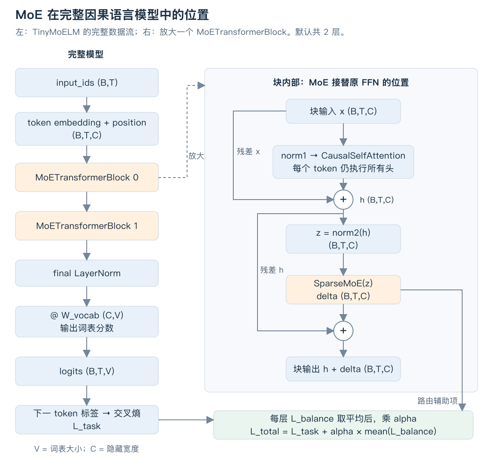
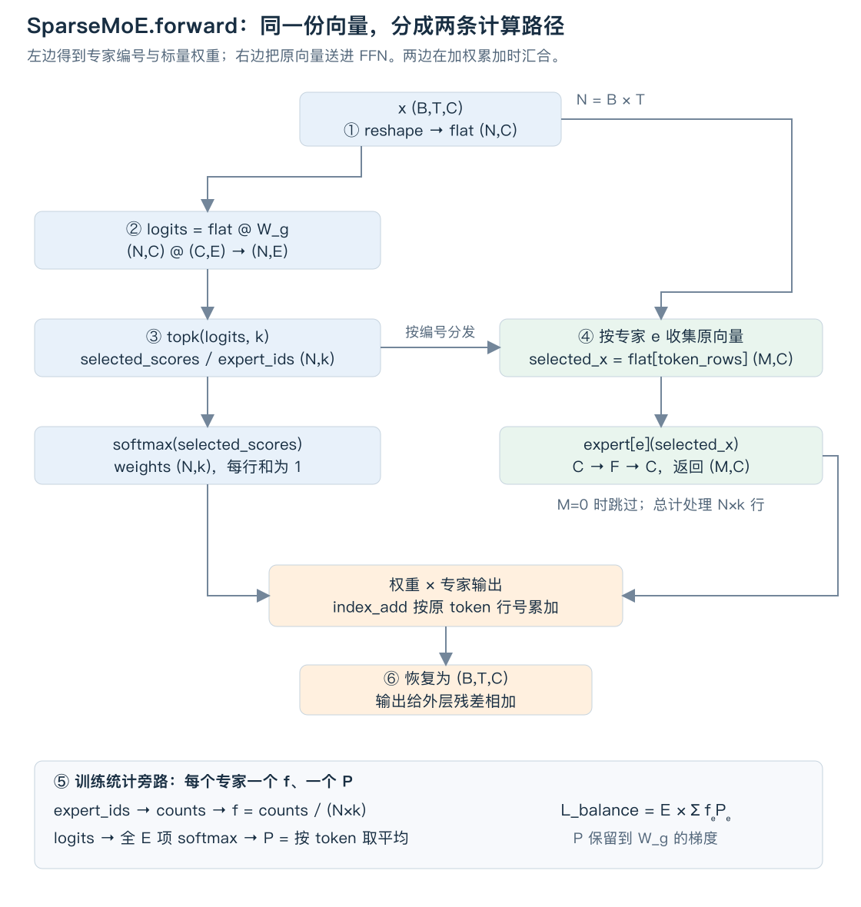

# 跟着完整代码走一遍 MoE

这份导读沿着一条数据流展开：**一个 token 的隐藏向量，怎样得到专家分数、进入选中的 FFN、合并回原位置，再参与语言模型训练。**

先运行一个可以手算的 MoE，再把同一个 `SparseMoE` 放进完整的小型因果语言模型。代码是按本次请求提供的完整教师参考实现；原有学习者作业保持原样。本例实现的是 **FFN 专家**，Attention 使用普通多头结构。

已有概念解释见 [MoE 主讲义](mixture-of-experts.md)；公式速览见 [sparse-moe.md](sparse-moe.md)。这里重点对照可运行代码，不要求重新阅读整份理论讲义。

## 1. 先运行，再顺着一个文件阅读

在项目根目录执行：

```bash
# 先只看两个 token 的每一步中间值，不训练
.venv/bin/python -B -m exercises.ex019_moe.moe inspect

# 再训练包含 Attention 和 MoE 的完整小模型，并从前缀生成
.venv/bin/python -B -m exercises.ex019_moe.moe train

# 不带参数会依次运行上述两部分
.venv/bin/python -B -m exercises.ex019_moe.moe
```

入口只依赖 PyTorch，不下载语料，不需要 GPU。每次运行在 CPU 上使用一个线程。这里所有 token 都有效，不包含 PAD。

全部实现集中在 [`exercises/ex019_moe/moe.py`](../exercises/ex019_moe/moe.py)，按下面四部分从上往下排列，也可以直接执行 `.venv/bin/python -B exercises/ex019_moe/moe.py inspect`。

| 阅读顺序 | 文件中的入口 | 看完应能对应的计算 |
|---|---|---|
| 1 | `ExpertFFN`、`SparseMoE.forward` | 路由 → 分组执行 → 加权累加 → 负载统计 |
| 2 | `make_inspection_case`、`inspect_routing` | 打印结果与手算例子逐项对应 |
| 3 | `MoETransformerBlock`、`TinyMoELM` | MoE 在整模型中的位置与词表输出 |
| 4 | `train_demo`、`main` | 损失、反向传播、参数更新和生成 |

核心代码没有待填写的 TODO，阅读和运行都使用同一个文件。

## 2. 把 MoE 放回完整架构



左边是默认的两层小模型，右边放大其中一个块。`B` 是 batch 大小，`T` 是序列长度，`C` 是隐藏向量宽度，`V` 是词表大小。除 token ID 和最终词表 logits 外，模型主干都保持 `(B,T,C)`。

在 `MoETransformerBlock.forward` 中，实际接线是：

```python
h = x + self.attention(self.norm1(x))
z = self.norm2(h)
delta, stats = self.moe(z)
return h + delta, stats
```

`h` 是 Attention 与第一条残差相加后的结果；`z` 是逐 token 归一化后的向量，已经包含上下文。这个 `z` 就是下一节 `SparseMoE.forward(x)` 收到的输入，局部函数把它命名为 `x`。

原本这里执行一个 `ffn(z)`，现在执行 `moe(z)`。MoE 返回的 `delta` 仍是 `(B,T,C)`，才能与 `h` 相加。**注意力没有被移动，FFN 没有被移动，改变的是 FFN 位置内部的计算。**

`stats` 是路由统计的返回对象，不加进隐藏向量；训练循环使用它里面的辅助损失。两层的路由器和专家参数各自独立。

## 3. 先认识一位专家和路由器的参数

`ExpertFFN` 沿用已经写过的两层 ReLU FFN：

```python
hidden = x @ self.W1 + self.b1
activated = torch.where(hidden > 0, hidden, 0.0)
return activated @ self.W2 + self.b2
```

若这位专家收到 `M` 行 token 向量，输入为 `(M,C)`，中间为 `(M,F)`，输出恢复为 `(M,C)`；`F` 是 FFN 的中间宽度。每行独立计算，只共享这一位专家的参数。

本参考实现选 ReLU，便于直接对照 ex008，并让后面的专家输出可以手算。速览中的 GELU、主讲义中的 SwiGLU 是其他专家内部结构；这里的路由、分发和加权合并规则相同。

`SparseMoE.__init__` 再创建：

- `W_g: (C,E)`：路由参数，`E` 是专家总数；每一列给一个专家打分。
- `experts`：`E` 个独立的 `ExpertFFN`。`nn.ModuleList` 是会登记子模块的容器，让优化器、保存参数和 `.to()` 都能找到这些专家。

每次循环都新建一位专家，因此同一结构拥有不同参数。这里 `W_g` 专门表示路由矩阵，专家自己的两张矩阵叫 `W1、W2`。

## 4. 沿着 SparseMoE.forward 的 ①～⑥ 看一次前向



图中的 `N=B×T` 是本批总 token 数。代码先把 `(B,T,C)` 展平成 `(N,C)`；原位置 `(b,t)` 对应行号 `n=b×T+t`。这一步只改变排列视角，不混合 token。

### ①～③：两个 token 分别选谁

`inspect` 固定 `B=1、T=2、C=2、F=2、E=4、k=2`。这里的 token 1、2 表示两个位置；在代码中它们的展平行号是 `0、1`。

```text
x_flat = [[1, 0],
          [0, 1]]
```

为了复现之前讲过的概率表，示例把 `W_g` 的两行设置为下表概率的自然对数。因为 `x_flat` 是单位矩阵，`x_flat @ W_g = W_g`；每行概率和为 1，所以 `softmax(log(p)) = p`。这样概率确实来自一次真实矩阵乘法，而不是绕过了路由器。

| token 行 | 专家 0 | 专家 1 | 专家 2 | 专家 3 | 选中专家 |
|---|---:|---:|---:|---:|---|
| 0 | 0.60 | 0.30 | 0.05 | 0.05 | 0、1 |
| 1 | 0.40 | 0.20 | 0.25 | 0.15 | 0、2 |

这是人为设置的教学参数；真实模型中的 `W_g` 从随机初始化开始训练。

代码先计算 `logits = flat @ W_g`，再取得两张不同用途的概率表：

| 变量 | shape | 沿什么轴归一化 | 用在哪里 |
|---|---|---|---|
| `probabilities` | `(N,E)` | 全部专家 | 计算平均概率 `P` 和辅助损失 |
| `weights` | `(N,k)` | 选中的专家 | 加权合并专家输出 |

`topk` 返回 `selected_scores` 和 `expert_ids`。对前者做 softmax 后：

```text
expert_ids = [[0, 1],        weights = [[2/3, 1/3],
              [0, 2]]                  [8/13, 5/13]]
```

`weights[1,1] = 5/13` 对应的是 `expert_ids[1,1] = 2`，所以它属于专家 2。第二个下标表示“选择槽位”，并不总是等于专家编号。

### ④：专家收到的是原向量，并把贡献加回原位置

代码按专家循环：

```python
token_rows, slots = torch.where(expert_ids == e)
```

`where` 在布尔表里找出所有 True，返回它们的行、列下标。以专家 0 为例，匹配位置是 `(0,0)、(1,0)`，因此 `token_rows=[0,1]`，`slots=[0,0]`。

接下来四行代码完成真正的计算：

```python
selected_x = flat[token_rows]
expert_output = expert(selected_x)
selected_weights = weights[token_rows, slots].unsqueeze(-1)
output = output.index_add(0, token_rows, selected_weights * expert_output)
```

`unsqueeze(-1)` 把每条分配的标量权重从 `(M,)` 改为 `(M,1)`，使它乘遍对应输出的 `C` 个特征。`index_add(0, ...)` 沿第 0 轴把每行贡献**累加**到指定的原行号；直接覆盖会丢失另一位专家的贡献。

本例把四个真实 FFN 的参数设置成：对当前非负输入，分别输出 `x、2x、-x、4x`。它们仍然通过完整的 `ExpertFFN.forward`，没有换成假函数。

| 专家 | 收到的原行号 | 实际计算 | 加回的贡献 |
|---|---|---|---|
| 0 | `[0,1]` | 两行分别输出 `[1,0]`、`[0,1]` | 行 0 加 `[2/3,0]`；行 1 加 `[0,8/13]` |
| 1 | `[0]` | 输出 `[2,0]` | 行 0 加 `[2/3,0]` |
| 2 | `[1]` | 输出 `[0,-1]` | 行 1 加 `[0,-5/13]` |
| 3 | `[]` | **没有调用 forward** | 无 |

最终：

```text
output = [[[4/3, 0],
           [0, 3/13]]]      # 恢复 (B,T,C)
```

总共处理了 `2+1+1=4=N×k` 行专家输入。若先让所有专家计算全部 token，再把未选中的输出乘零，就会处理 `N×E=8` 行，无法省掉这部分计算。

运行入口里的 `register_forward_hook` 是“模块执行后观察输入、输出”的回调，仅用于打印上述过程；它还会检查专家 3 确实没有被调用。核心 MoE 不依赖 hook。

### ⑤～⑥：同一份路由产生辅助损失，再返回主干输出

`counts` 是分配次数；`fractions` 对应公式中的 `f`；`mean_probabilities` 对应 `P`：

```text
counts = [2, 1, 1, 0]
f = counts / (N*k) = [0.50, 0.25, 0.25, 0.00]
P = probabilities.mean(0) = [0.50, 0.25, 0.15, 0.10]
L_balance = 4 * sum(f * P) = 1.4
```

代码返回 `(output, stats)`：`output` 接回残差主干，`stats.balance_loss` 接入训练目标。`RoutingStats` 使用 `dataclass` 把这些具名字段装在一起，便于通过 `stats.counts` 等名字读取。

## 5. backward 时，路由器和专家分别从哪里学习

主任务的路径是：

```text
W_g → 选中分数 → weights → 专家加权和 → 后续模型 → L_task
专家参数 → expert_output → 专家加权和 → 后续模型 → L_task
```

辅助项的路径是：

```text
W_g → 全专家 probabilities → P → L_balance
```

`expert_ids` 是整数选择，`counts/f` 是硬统计，不通过它们对“改变专家编号”求普通梯度。选中的分数仍然参与连续计算，因此 `weights` 能传回梯度。完整公式推导见[主讲义第 5 节](mixture-of-experts.md#5-没有正确专家标签路由器怎么学)。

`inspect` 用 `target=x` 构造一个小回归损失，分别打印主任务、辅助项对 `W_g` 的梯度。你能直接观察到：

- 主任务对没有被选中的专家 3 的**路由列**梯度为零。
- 辅助损失经过全专家概率，对这一路由列仍能给出梯度。
- 专家 3 的 **FFN 参数**没有参与本次计算，因此仍然没有梯度。辅助项不会直接训练这个闲置 FFN。

打印时才使用 `detach()`；核心前向保留计算图。如果提前把 `weights` 或 `P` detach，这两条路会被切断。`inspect` 只观察前向和反向，没有执行参数更新。

本实现明确限制 `2 <= top_k <= num_experts`。直接把 `k` 改为 1，又对唯一选中分数做 softmax，权重会恒等于 1，主任务经混合权重到路由器的梯度会消失。需要 Top-1 时，应先选择另一种门控约定，而非仅改配置。

## 6. 从玩具层接到完整训练与生成

`train_demo` 使用两条等长序列，ID 从 `VOCAB=("A","B","x","u","v")` 得到：

```text
A x u x u x u x u
B x v x v x v x v
```

`inputs = ids[:, :-1]`，`targets = ids[:, 1:]`。两行第 2 个位置的输入都是 `x`，目标分别是 `u、v`；模型必须利用前面的上下文，不能仅靠当前位置的 token 和位置编号区分它们。

完整模型先产生词表 logits，再计算：

```python
optimizer.zero_grad(set_to_none=True)
logits, balance_loss, routing = model(inputs)
task_loss = next_token_loss(logits, targets)
total_loss = task_loss + alpha * balance_loss
total_loss.backward()
optimizer.step()
```

`next_token_loss` 用减最大值和对数归一化展开交叉熵；模型输出端不提前 softmax。所有位置都参与这个任务损失。`balance_loss` 是**各层辅助项的平均值**，`alpha` 只在训练循环乘一次。

`greedy_generate` 只接收两个前缀 `A x` 和 `B x`，每轮取末位置 logits 的最大值作为新 ID，追加到输入后继续前向。没有 KV Cache，因此每轮重算整个前缀。生成过程使用 `eval/no_grad`，结束后恢复调用前的模式。

本例用同样的 Top-2 规则训练和生成；没有随机路由，也没有按 batch 容量丢弃 token。辅助损失本身不改变前向隐藏向量，生成时可以忽略它。

默认运行配置为 `C=24、H=3、F=48、2 层、E=4、k=2、seed=42、alpha=0.01、Adam lr=0.01`。在本地 CPU、PyTorch 2.14.0、float32 上实际运行 160 步得到：

| 观察项 | 初始 | 160 步后重新前向 |
|---|---:|---:|
| 主任务交叉熵 | 2.277214 | 0.000287 |
| 固定两条序列的目标 token 准确率 | 18.8% | 100% |
| 两层平均负载辅助项 | 1.2218 | 0.9567 |

从两个前缀分别生成 7 个 token，均匹配对应完整序列。这证明此处训练与生成接线能工作，**只是在拟合两条固定序列，不是泛化评测，也没有验证某个专家形成了语义专长**。其他版本或设备的末位数值可能不同。

这次第 0 层的分配次数为 `[8,8,8,8]`，第 1 层为 `[8,5,8,11]`。每层总和都是 `B×T×k=32`。辅助项小于 1 可以发生，不能拿“是否到 1”作为均衡验收线；仍要看实际分配。

## 7. 用实际代码核对参数量和边界

一位带偏置 ReLU 专家的参数量是 `P_expert=2CF+F+C`。本例一层 MoE：

```text
P_expert = 2×24×48 + 48 + 24 = 2376
P_router = C×E = 24×4 = 96
总参数   = E×P_expert + P_router = 9600
每 token 使用 = k×P_expert + P_router = 4848
```

所有专家权重都保存在模型里。单个 token 只执行其中两位专家；一个 batch 仍可能使用全部专家。这些数字只统计 MoE 子层，不包括 Attention、归一化、embedding 或词表输出层，也不是内存峰值或运行时间。

本实现使用 Python 按专家循环和 `index_add` 来把数据流写清楚，适用于 CPU 小规模学习。没有实现 PAD 排除、容量上限、跨设备专家并行或高性能融合内核。若输入含 PAD，必须先补有效位置分发和统计，不能直接套用 `N=B×T`。

## 8. 已运行的正确性验证

```bash
.venv/bin/python -B -m unittest tests.exercises.test_moe -v
```

验证包括手算中间值、真正跳过未选专家、与“全专家计算后掩码”的独立参照比较前向和梯度、路由主任务/辅助项的不同梯度路径、非连续输入、token 重排与分块、极端分数、模型因果性、参数保存恢复，以及训练后自由生成。

这些测试验证的是教师实现，不自动更新学习进度。后续自己实现或排错时，可以把本实现作为对照。

图解的可编辑源是本目录资源中的 [SVG 架构图](assets/moe-walkthrough/architecture.svg)、[SVG 路由图](assets/moe-walkthrough/routing.svg)；需要修改布局时可编辑并运行 [render_diagrams.py](assets/moe-walkthrough/render_diagrams.py)，它使用系统 `rsvg-convert` 生成 PNG。
