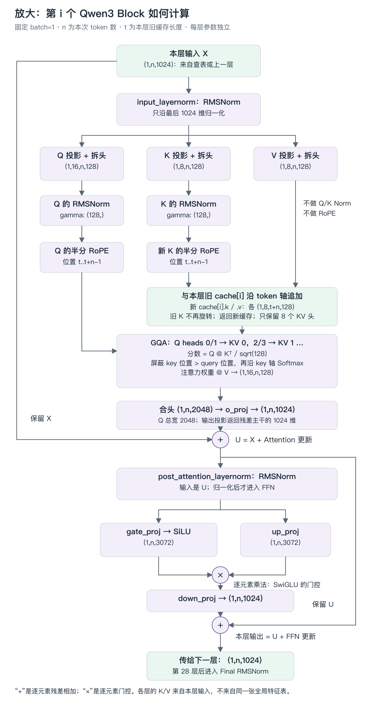

# 从自己训练的小模型，走到真实 Qwen3 推理

这次不再添加一串新架构：我们要把已经会的组件接到一个**别人训练好的、真实可聊天的模型**上。
最终产物是一条可检查的路径：使用官方 tokenizer 把问题变成 ID，由你写的模型产生 logits，
再由你写的缓存与生成循环输出回答。Hugging Face 的模型实现只做独立裁判，不参与正式 demo。

选定 [Qwen/Qwen3-0.6B](https://huggingface.co/Qwen/Qwen3-0.6B)，固定 revision：

```text
c1899de289a04d12100db370d81485cdf75e47ca
```

revision 是仓库某次提交的标识。固定它，是为了避免以后 config、tokenizer 或权重更新，
导致同一份代码悄悄换了输入条件。这不是“复刻所有 Qwen”，而是准确支持这个 checkpoint。
checkpoint 在这里指模型配置、训练所得的参数和配套分词文件，不是某个正在生成的请求状态。

第一版限定 **CPU、float32、单请求生成、短输入、完整因果 Attention、贪心选择**。
不训练、不量化、不做 HTTP 服务，不要求 GPU，也不把滑窗或 FlashAttention 强塞进去。
这个 checkpoint 本身没有启用滑窗；改成滑窗就不再是同一个数学模型。

## 整个 demo 的计算架构

先看总览：参数是长期固定数据，KV Cache 是本请求逐轮增长的状态，新 token 是下一轮的输入。
图中 `n` 是本次输入长度，`t` 是此前已经缓存的长度；demo 固定 `B=1`。
下面画的是待实现的目标链路，不代表 `model.py` 中的核心函数已经完成。


关键是两条不同的回送：刚预测的 **ID** 送回模型入口；各层返回的 **new_cache** 作为下一轮历史。
prefill 用整个 prompt，末位 logits 就产生第一个新 token；decode 只送上一次预测出的一个 token。
命中 EOS 或达到输出预算后，直接解码结果，不再为最后一个 token 跑前向。
图画的是正输出预算的主路径；预算为 0 时直接返回空的新增 ID 序列。
HF 数值参照 `compare_hf.py` 是独立验证入口，不在这条正式推理链路上。

再把图中的单个 Block 展开，看清 Q/K/V 的分叉、缓存追加和两条残差旁路：



图中的 Norm 与投影都使用该层对应权重；Q/K Norm 的 gamma 各为 `(128,)`，同一层内跨 head 共享。
Q 合头宽度是 2048，经输出投影回到 1024 后才与 X 相加。缓存只保留 8 个 KV 头，
不会把读取时可能临时扩展的 16 头版本永久存进去。

可缩放原图：[总览 SVG](assets/qwen3-inference/overview.svg)、[Block SVG](assets/qwen3-inference/block.svg)。

## 1. 已经写过 LLaMA 风格，为什么不能直接塞权重？

你以前的模型可以自己规定参数长什么样，再训练它适应这些规定。
现在方向反过来了：训练已经结束，参数每一行、每一列对应的计算意义已经固定。
**形状能装进去，只证明接口没有报错；不证明执行了训练时的计算。**

沿用已经理解的主干：embedding、Pre-RMSNorm 块、GQA、RoPE、SwiGLU、final RMSNorm、词表投影。
本次新增难点集中在四个接缝：权重布局、Q/K 归一化、RoPE 配对、真实输入/停止协议。
它们不是让你猜的新考点，下面先把规则与原因说清。

三个文件各解决不同问题：

| 文件 | 它告诉程序什么 | 它不负责什么 |
|---|---|---|
| `config.json` | 层数、宽度、头数、head_dim、epsilon、RoPE theta 等计算约定 | 不包含训练后的大矩阵 |
| `model.safetensors` | 按名称保存的参数 Tensor | 不替你执行前向或管理请求缓存 |
| `tokenizer.json` / `tokenizer_config.json` | 文本怎样转成 ID、对话怎样包装成训练见过的形式 | 不产生下一 token 的 logits |

`safetensors` 是保存命名 Tensor 的文件格式。这次用它读取数组，不把反序列化或 BPE 编码实现
变成学习重点。BPE 的词表与合并规则由官方 tokenizer 使用；不能换成以前的小字符词表。
同一个 ID 对应哪个 embedding 行，本来就已经被训练固定了。

## 2. 从 ID 出发，把矩阵方向与实际宽度接对

设本次输入为 `input_ids: (B,n)`，其中 n 是**本次送入**的 token 数，不一定是总历史长度。
查表 `model.embed_tokens.weight: (151936,1024)` 后得到 `X: (B,n,1024)`。
这里没有要再加一次的绝对位置表，也不额外给 embedding 乘 `sqrt(1024)`。

旧练习通常把 W 存成 `(in,out)`，然后 `X @ W`。HF 的线性权重存成 `(out,in)`：
每一行是一项输出特征使用的全部输入系数。读取时不乱改文件，只在使用时处理方向。

```text
本层 norm 后的 X: (B,n,1024)
q_proj.weight:    (2048,1024)
Q = X @ q_proj.weight.T: (B,n,2048)
```

`.T` 在这里用于二维权重，交换其行列；高阶张量仍用明确的 `transpose`。
方阵时方向写反不会报 shape 错，因此验收会用非方阵，而不是只拿 1024×1024 自证正确。

还有一个不能从旧实现搬来的假设：**本模型的 C 不等于 Hq×D**。
官方配置明确给 `head_dim=128`，不是让你用 `1024/16` 推导出 64。

| 对象 | 来源 / 布局 | 本模型 shape |
|---|---|---|
| X | 残差主干 | `(B,n,1024)` |
| Q | 投影 2048 维后拆成 16 头 | `(B,16,n,128)` |
| K、V | 分别投影 1024 维后拆成 8 头 | 各 `(B,8,n,128)` |
| 每头读取结果 | Q 的 16 条读取路径 | `(B,16,n,128)` |
| 合头结果 | 把各头结果放回特征轴 | `(B,n,2048)` |
| o_proj 输出 | `(1024,2048)` 权重把读取结果转回主干宽度 | `(B,n,1024)` |

所以残差加法仍合法：不是让 `(B,n,2048)` 直接加到 X，而是先由输出投影返回 1024。
这正好用一次真实实现巩固：隐藏宽度、头数、每头维度是需要看配置的不同对象。

## 3. Q/K 投影之后还要做什么？

在旧的 LLaMA 风格块里，Q/K 投影、拆头后直接做 RoPE。这个 Qwen3 还增加一层处理：

**对每个 token、每个 head 的 128 维 Q/K 向量，分别做 RMSNorm，然后才旋转。**
Q 用 `q_norm.weight`，K 用 `k_norm.weight`；两份权重都是 `(128,)`，
同一层内跨 token、跨 head 共享。不是每个 head 各有一份 128 维 gamma，也不是跨头求均值。

为什么它会改变读取？原本把 q 乘 10，未归一化的点积分数也会乘 10，Softmax 通常会更尖锐。
如果先做 RMSNorm，在 epsilon 可忽略时，把 q 乘正数 10 基本会被分母抵消。
于是匹配分数不再同样地受投影结果整体幅度支配；可学习 gamma 仍能按维度调整分量。
这解释了它改动的量，不代表“Q/K 的模长永远固定”或“所有模型必须这样设计”。

对我们当前的目标，更直接的理由是：**这些参数就是按有 Q/K Norm 的前向训练的。**
省掉它不一定报错，但会换掉每一层的注意力分布。V 是被读取的内容，不使用这两次 Q/K Norm，
也不旋转。

RoPE 还存在一个更隐蔽的“shape 一样、结果不同”：

```text
只看一个 head 的 D=4 向量 x=[a,b,c,d]：
以前相邻配对： (a,b)、(c,d)
Qwen 半分配对：(a,c)、(b,d)
```

本模型实际 `D=128`，配对是 `(x[j], x[j+64])`。
第 j 对的频率是 `theta**(-2*j/D)`，`j=0..D/2-1`，角度是“绝对位置 × 频率”。
一对 `(a,b)` 在角度 φ 下变成 `(a cosφ-b sinφ, a sinφ+b cosφ)`。
两种布局可以通过一致的坐标重排建立对应，但**不能固定已训练的 Q/K 权重，却单独换配对**。

为什么旧测试可能放过这个错误？位置为 0 时，所有角度都是 0，两种实现都返回输入。
所以本题用非零位置检查；这比再检查一次 shape 更有意义。
theta 从配置读，真实值是 `1,000,000`，不能沿用旧练习的 `10,000`。

## 4. 把一个块闭合，再把 28 层接起来

完成上述差异后，剩下的块内数学都学过。按数据来源看整个块：

1. 保留本层输入 X，把归一化后的 X 送入 Q/K/V 投影。
2. Q/K 分头、各自归一化、RoPE；V 只分头。Q 读取本层 K/V。
3. 读取结果合头、经 o_proj 回到 C 维，加回原始 X，得到 U。
4. U 的归一化结果送入 gate/up 两条投影；SiLU(gate) 与 up 逐元素乘，再 down 投影回 C。
5. 把这次 FFN 更新加回 U，得到本层输出。

第 4 步用的参数虽然叫 `post_attention_layernorm`，它表示在 Attention 后、FFN 前出现，
并不表示把整个块改成 Post-LN。两个残差的直接路径都保留未归一化的子层输入。

以下是**第 i 层**的完整参数映射，名称前缀为 `model.layers.i.`：

| 键后缀 | shape | 用途 |
|---|---|---|
| `input_layernorm.weight` | `(1024,)` | 第一条分支的 RMSNorm |
| `self_attn.q_proj.weight` | `(2048,1024)` | Q 投影 |
| `self_attn.k_proj.weight` / `v_proj.weight` | 各 `(1024,1024)` | K/V 投影 |
| `self_attn.q_norm.weight` / `k_norm.weight` | 各 `(128,)` | 每个 Q/K head 的 RMSNorm |
| `self_attn.o_proj.weight` | `(1024,2048)` | 合头后返回主干宽度 |
| `post_attention_layernorm.weight` | `(1024,)` | FFN 分支的 RMSNorm |
| `mlp.gate_proj.weight` / `up_proj.weight` | 各 `(3072,1024)` | SwiGLU 的两条输入投影 |
| `mlp.down_proj.weight` | `(1024,3072)` | FFN 返回主干宽度 |

全部没有 bias。本层输出作为下一层输入，重复 28 层，最后经 `model.norm.weight: (1024,)`，
再用 `lm_head.weight: (151936,1024)` 得到 `logits: (B,n,151936)`。
这些 logits 还是分数，不是已经选好的 token。

这里配置了 **weight tying（权重共享）**：词表输出和输入 embedding 使用同一份参数。
查表是取 E 的行，输出则是与 E 的各行做点积；用途不同，不妨碍参数相同。
loader 会给 `lm_head.weight` 建立对 E 的引用，不随机生成第二张词表矩阵。
实际文件同时存了两份键，加载器先检查数值一致，再共享；不能默默吞掉不一致的权重。

## 5. 能处理完整输入之后，为什么还需要另一个状态？

参数描述“怎么计算”；cache 描述“这个请求已经算到哪里”。二者不能混放。
同一份固定 weights 可以处理很多问题，但问题 A 的历史 K/V 不能拿去接问题 B。

每层缓存保存 `K,V: (B,8,t,128)`。t 是已经处理的 token 数，K 已做本层归一化和旋转。
首次传 `cache=None`；函数返回新的 cache，下一次由调用者显式传回。
本题不用全局变量，也不修改传入的旧 cache，便于保留旧状态做对照和避免请求串用。

GQA 的“共享”发生在读取关系上：16 个 Q head 中，0/1 读 KV head 0，2/3 读 KV head 1，依此类推。
临时把 KV 重复到 16 头来做矩阵乘法可以，**持久缓存仍只存 8 头**。

同一个 forward 处理两个阶段：

| 调用 | 新输入 | 新 Q 的绝对位置 | 参与读取的 K |
|---|---|---|---|
| prefill | 整个长度为 5 的 prompt | `0,1,2,3,4` | `0..4`，每行仍遵守因果 |
| decode | 刚刚预测出的 1 个 ID | `5` | `0..5` |
| 多 token 追加测试 | 旧 cache 长 5，再送 2 个 ID | `5,6` | `0..6`，query 5 不能看 key 6 |

最后一行能抓住一个常见简化：**“有 cache 就不需要 mask”只在追加恰好一个 token 等条件下成立**。
稳妥做法是统一比较绝对位置：`key_position <= query_position`。
这一规则同时适用方阵 prefill 和矩形追加，不用根据 offset 是否为零切换数学逻辑。

历史 K 不要再旋转，新 Q/K 也不要每次从位置 0 开始。
同一串 ID，无缓存全量前向与 `[前缀、多 token 块、最后一个 token]` 分段执行，
每个对应位置的 logits 应在容差内一致。不只比较最后一个 argmax。

## 6. 从 logits 到一段真正的回答

首先还缺“模型认为对话从哪里开始回答”的约定。随便输入一句中文与输入一条规范的聊天消息，
可以得到不同的 token 前缀。chat template 是把角色、正文、结束标记和待生成的 assistant 前缀
排成模型训练见过的格式，不是模型内部的额外计算层。

辅助代码会调用官方 tokenizer 的：

```python
tokenizer.apply_chat_template(
    [{"role": "user", "content": "用一句话解释什么是 KV Cache。"}],
    tokenize=True,
    add_generation_prompt=True,
    enable_thinking=False,
    return_tensors="pt",
)
```

`tokenize=True` 表示直接返回 ID；`return_tensors="pt"` 让结果成为 PyTorch Tensor。
`add_generation_prompt=True` 添加 assistant 开始位置；`enable_thinking=False` 选择非思考模板。
模板可能包含空的 `<think>` 标记，这是已构造的输入，不代表推理器还缺某个思考模块。
不要再手动追加 BOS，也不要先套模板后重复添加特殊 token。

随后由你实现生成循环。假设 prompt 是 `[p0,p1,p2]`：

| 模型调用 | 送入的 ID | 从哪取下一步分数 | 本次得到 |
|---|---|---|---|
| 第一次 | `[p0,p1,p2]`，空缓存 | 最后位置 p2 的 logits | 新 token a |
| 第二次 | `[a]`，带 prompt 缓存 | a 的 logits | 新 token b |
| 第三次 | `[b]`，继续缓存 | b 的 logits | 结束 token |

第一步的 a 已经由 prefill 末位产生，不能再把 p2 送一次，那会把 prompt 的最后一个 token 重复计算进历史。
新 token 一旦命中结束集合，收下它并停止，不为它再跑一次模型。
本模型 `generation_config.json` 的结束集合是 `[151645,151643]`，不是只看 `config.json` 的单个 ID。
`max_new_tokens` 只计新增输出，不是“prompt 加输出的总长”；本题保守地提前为完整输出预算预留位置。

第一版选 logits 最大的 ID 即可。Softmax 保持排序，因此贪心不必先算概率。
正的 temperature 也不改变 argmax，所以这里不提供一个看似可调、实际上不影响选择的温度开关。
这是便于定位错误的确定性基线，不是官方推荐的最佳聊天采样配方；以后可接上已经学过的采样。

输出时一次 decode 新增 ID 序列，不简单逐 ID 解码后拼字符串：一个汉字可能由多个 token 表示，
孤立解码可能产生替换字符。流式正确解码留给下一版，不影响本次模型闭环。

## 7. 怎么判断“真的接对了”，而不是碰巧像在说话？

测试逐步把不确定性隔离，而不是每次都加载大模型等一段文本：

1. **离线小权重**：构造很小但保留 `C != Hq*D`、GQA、非均匀 Q/K gamma 的模型。
   验证权重方向、RoPE 配对、单块数字与生成调用顺序，不需要下载任何模型。
2. **官方随机小模型**：用固定版本 Transformers 创建相同小配置，把它的参数原样交给你的函数。
   对比完整 logits 和缓存追加。它没有语言能力，只负责裁判数学与布局。
3. **同一个真实 checkpoint**：两个实现使用相同 ID、CPU float32、eager Attention 与关闭求导，
   对齐后再运行你的聊天 demo。eager 在这里指显式分数/Softmax/读取路径，而不是融合 Attention 后端。

先看哪个边界开始偏离：查表 → 第一层输出 → 最后一层 → final norm → logits。
一开始就不同，优先查参数名/转置/配置；全量对、增量错，优先查位置、重复 token、旧 K 重旋转和 mask。
CPU 的浮点路径也不保证逐位一致，所以用预先声明的容差，不用字符串相同替代数值验证。

`torch.inference_mode()` 是外层推理上下文：关闭求导及一些跟踪开销。
它不替你创建 cache，不决定下一 token，也不是 Attention 的某种近似算法。
`@dataclass` 用于给 config/cache 这些具名字段自动生成构造函数，可把它理解成比 Go struct 多一些自动方法；
`LayerKV | None` 表示参数可为缓存对象或空值，`tuple[...]`/`list[...]` 是类型说明，不执行张量运算。

## 8. 这次你写什么，我提供什么

进入 [ex021 作业说明](../exercises/ex021_qwen3_inference/README.md)。核心实现集中在一个 `model.py`：
RMSNorm → RoPE/GQA → 单块 → 整模型 → 贪心生成，共 6 个核心函数。
投影可直接写 `x @ weight.T`；`linear` 辅助函数可选，不再单独验收。
加载器、官方 tokenizer、下载入口、命令行外壳和测试由教师提供；不隐藏一份可直接调用的完整模型答案。
旧练习和这份规格可以查，这不是闭卷，也不要求重新训练一个 0.6B 模型。

权重文件实际约 **1.50 GB（1.40 GiB）**；共享后常驻 float32 参数约 **2.22 GiB**。
后者不是总内存：加载、KV、Attention 中间量、词表 logits 都额外占空间。
因此从短 prompt 开始，真实 HF 对照与自写模型尽量分阶段加载；不预先承诺本机 tokens/s。
权重只在显式执行下载入口时获取，保存到被 Git 忽略的 `checkpoints/`，不提交进仓库。

完成材料不会修改你的掌握状态。后续验收会区分你写出的代码、教师测试、以及你自己定位的故障；
这份工程可补强真实权重接入和独立集成证据，不自动代表 T5、ALiBi 或所有毕业关卡都完成。

## 核对来源

- 项目范围参考：[古法手撕简易 LLM 推理器](https://fanzheng.org/post/gu-fa-shou-si-jian-yi-LLM-tui-li-qi.html)。
  我们沿用小模型、Tensor 前向、现成分词与权重读取的范围；额外明确多 token cache 对齐、停止集合与固定版本。
- 精确参数来自 [固定 revision 的 config](https://huggingface.co/Qwen/Qwen3-0.6B/blob/c1899de289a04d12100db370d81485cdf75e47ca/config.json)
  和 [generation_config](https://huggingface.co/Qwen/Qwen3-0.6B/blob/c1899de289a04d12100db370d81485cdf75e47ca/generation_config.json)。
- 布局与顺序依据 [Transformers v4.51.3 的 Qwen3 实现](https://github.com/huggingface/transformers/blob/v4.51.3/src/transformers/models/qwen3/modeling_qwen3.py)
  和 [RoPE 参数实现](https://github.com/huggingface/transformers/blob/v4.51.3/src/transformers/modeling_rope_utils.py)。
- 模板、非思考模式与采样边界见 [官方模型卡](https://huggingface.co/Qwen/Qwen3-0.6B)。
  选这套固定版本是为了可复现，不声称它是最新依赖。
